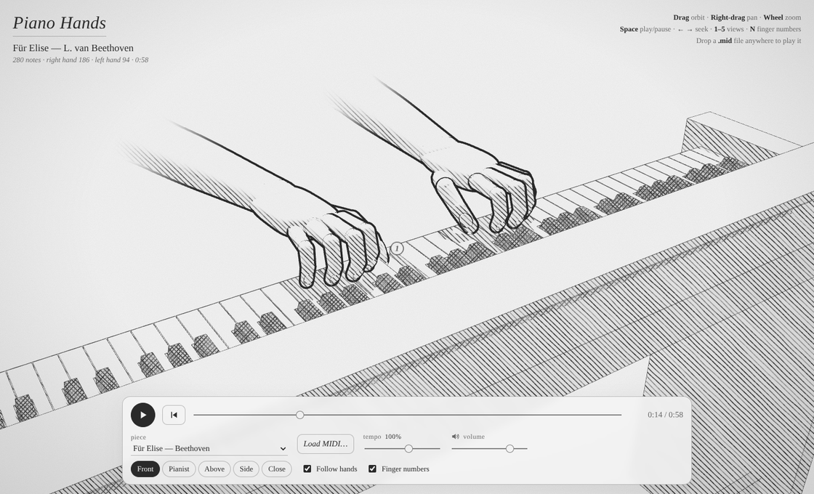

# Piano Hands

A 3D pair of hands that plays the piano, drawn like a pencil sketch. The hands work out their own fingering and movements, so they can play any MIDI file an intermediate pianist could play. Für Elise is built in as a demo.



## Run it

It's a static site with no build step (three.js is vendored in `vendor/`):

```bash
cd piano-hands
python3 -m http.server 8000      # or: npm start
# open http://localhost:8000
```

On GitHub Pages it is served at `/piano-hands/`.

### Controls

| | |
|---|---|
| Drag / right-drag / wheel | orbit / pan / zoom (touch: one finger, two fingers, pinch) |
| `Space` | play / pause |
| `← →` | seek ±5 s, `Home` back to start |
| `1`–`5` | camera views: front, pianist, above, side, close |
| `F` / `N` | follow the hands / show finger numbers |
| **Load MIDI…** or drag & drop | play any `.mid` file |

The tempo slider slows the piece down (25–150%) so you can study the fingering.

## How it works

All motion is a deterministic function of score time, so playback can be paused, scrubbed and slowed down.

```
MIDI / built-in score
   │  notes (pitch, start, end, velocity) + sustain pedal
   ▼
hand split ── fingering.js: by staff when there are two tracks. Otherwise
   │          dynamic programming over chord groups: each hand pays for
   │          stretching past an octave, for travelling (more when fast), for
   │          crossing the other hand and for leaving its register, and whole
   │          paths are compared. Notes held only by the pedal are released
   │          when the hand plays again
   ▼
fingering ─── fingering.js: dynamic programming (Viterbi) over chord groups,
   │          with the ergonomic cost model of Parncutt et al. (1997) and the
   │          span table measured by Jacobs (2001). It also covers chords, black
   │          keys (thumb/little finger), thumb crossings, held keys, and hand
   │          shifts, which cost more the less time there is
   ▼
motion plan ─ performance.js
   │  wrist: for every onset, the range of wrist positions from which its
   │         notes and the keys still held are within each finger's sideways
   │         reach. The wrist takes the calmest path through those ranges
   │         ("economy of motion"), so it follows slow changes of register
   │         and leaves quick ones to the fingers. Moves are unhurried and
   │         arrive just before the onset. The hand turns with the forearm
   │         and a little extra for thumb crossings, rolls towards the active
   │         fingers, lowers and flattens for wide chords, and dips into accents
   │  fingers: press (tip rides the moving key surface), approach (a lift and
   │         strike arc that hits the key with speed, higher when crossing over
   │         the thumb), release (follows the key up, relaxes) or rest
   │         (relaxed curl that follows its neighbours, with tendon coupling:
   │         idle fingers sag when a neighbour presses)
   ▼
skeleton ──── hand.js: anatomical bone lengths (≈19 cm hand, 8.5 cm palm).
   │          At rest the hand is gently arched with its five fingertips over
   │          five neighbouring white keys. Each finger is solved
   │          analytically: MCP abduction, then MCP/PIP flexion with DIP
   │          coupled to PIP (DIP ≈ 0.5·PIP, as when the pad rests on a key).
   │          The thumb has a mobile CMC saddle joint. All joints are clamped
   │          to anatomical ranges
   ▼
render ────── piano.js: 88 keys at real dimensions (23.5 mm white key pitch,
              10 mm dip at the front, black keys raised 12.5 mm), pivoting
              like real key levers
              sketch.js: lighting and shadows turned into screen-space
              cross-hatching on paper, with ink outlines
```

The sound comes from a small synthesiser in `audio.js`: inharmonic partials, two detuned strings, a hammer knock, dampers and the sustain pedal. No samples are needed.

### Checked against real pianists

The wrist planner, the hand's rest shape, its turn with the forearm and the hand split are calibrated against PianoMotion10M, a dataset of real pianists' hand poses. On videos not used for tuning, our wrist paths correlate 0.77 with the real ones (median) with a typical error of 3.4 cm, and the wrist's spread and peak speed match the real ones. The method, the numbers and the scripts are in [`tools/pianomotion/`](tools/pianomotion/README.md).

### What it can't do

* At most five notes per hand at once. If a chord is wider than the hand can stretch, the keys out of reach still go down and sound, but no finger is sent to them (the piece info shows how many).
* MIDI files without a separate staff for each hand get split automatically. That works for most piano music, but crossed-hands passages may come out differently from the score.
* Fingering is computed, not read from the score. It is usually what a teacher would write (scales 1-2-3-1-2-3-4-1, arpeggios 1-2-3-1-2-3-5, Für Elise 5-4-5-4-5), but not always.

## Tests

```bash
npm install   # dev dependency: three (same version as vendor/)
npm test
```

The tests check standard fingerings, that no finger plays a new key while holding another, how closely fingertips stay on the keys (99% within 3 mm in Für Elise), the rest shape of the hand, that the wrist stays still in a five-finger pattern, the hand's turn, pedal-held notes, MIDI parsing and hand splitting.

`node tools/contact-report.mjs [file.mid]` prints fingertip accuracy and the worst cases for any piece.

## Files

```
index.html, style.css   UI
src/main.js             scene, transport, audio scheduling, camera
src/piano.js            keyboard geometry & layout
src/hand.js             skeleton, meshes, IK
src/fingering.js        hand split + fingering
src/performance.js      motion planning
src/sketch.js           pencil-hatching materials
src/audio.js            piano synthesiser
src/midi.js             Standard MIDI File parser
src/scores.js           Für Elise + technical study
tools/contact-report.mjs  fingertip accuracy for any piece
tools/wrist-path.mjs      export the planner's wrist paths for a MIDI file
tools/pianomotion/        comparison with real pianists (PianoMotion10M)
vendor/                 three.js r170 (MIT)
```
